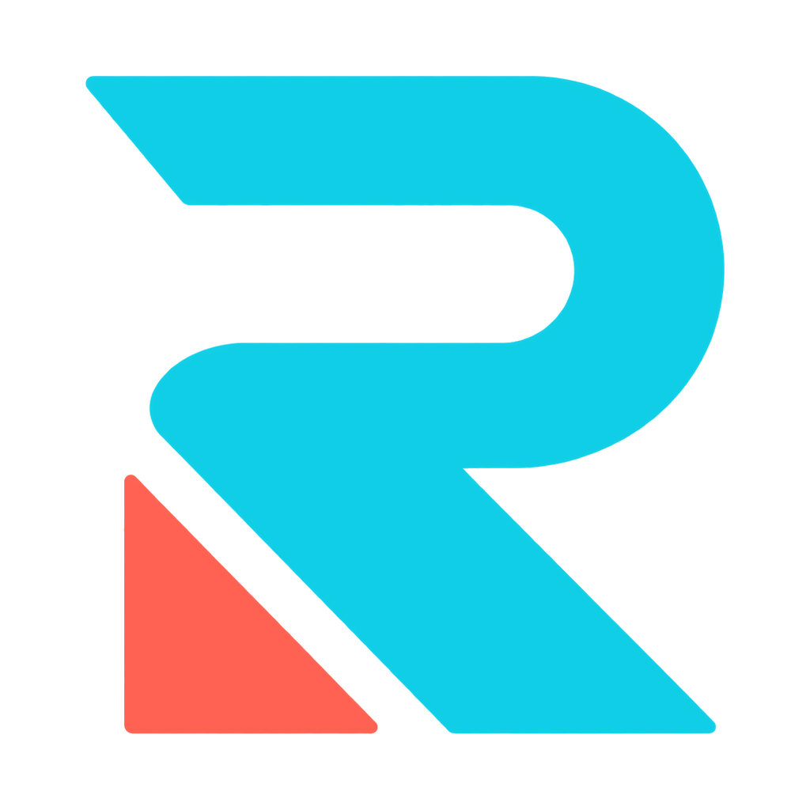

<p align="center">
  
</p>

<h1 align="center">Reoteab</h1>

<p align="center">
  <strong>A flexible Sol's RNG macro for fishing, merchant checks, biome alerts, and more.</strong><br>
  Set up the features you use, save your presets, and stay in the loop.
</p>

<p align="center">
  <a href="https://github.com/DeeepXD/Reoteab/releases"><strong>Download Reoteab</strong></a>
  &nbsp;·&nbsp;
  <a href="https://discord.gg/bQNSU3pfPF">Join the Discord</a>
  &nbsp;·&nbsp;
  <a href="https://github.com/DeeepXD/Reoteab/issues">Report an issue</a>
</p>

<p align="center">
  <a href="https://github.com/DeeepXD/Reoteab/releases"></a>
  
  
</p>

---

## Meet Reoteab

Reoteab is a community-maintained Sol's RNG macro for longer sessions. It continues the Noteab → Coteab lineage with current paths, calibration tools, preset support, and ongoing reliability work.

Whether you want a focused fishing setup or a more complete session with merchant checks, biome alerts, and Discord notifications, you can enable only the parts you use.

> Tester build: **Reoteab 1.0 Beta 2** (`v1.0.0-beta.2`)

## What you can do

| Spend less time repeating setup | Keep an eye on what matters | Make it fit your setup |
| --- | --- | --- |
| Fish automatically and continue through normal session flow. | Detect biomes and send Discord webhook notifications. | Calibrate visible Roblox controls for your resolution and layout. |
| Check supported merchants, read items with OCR, and buy configured items. | Use optional Discord remote control and webhook customization. | Save named macro presets with optional images, then switch setups quickly. |
| Use current VIP/non-VIP fishing and Captain Flarg routes. | Review activity and logs when something needs attention. | Import/export calibrations and create custom themes. |

Reoteab also includes recovery and failsafe behavior for the automation it supports. Roblox UI updates can still change how any macro behaves, so calibration and real-session testing matter.

## Get started

### 1. Download the official build

Get `Reoteab.exe` from the [Releases page](https://github.com/DeeepXD/Reoteab/releases). Put it in its own folder, then launch it.

Only download builds from this repository or an official project link. Avoid reuploads and modified copies you cannot verify.

### 2. Set up the features you want

Open Reoteab and choose your own mix of fishing, merchant automation, biome detection, webhooks, presets, and other options. You do not need to turn everything on.

### 3. Calibrate before a long session

Calibration tells Reoteab where your Roblox UI is. Use the built-in calibration tools, including fish-indicator auto-calibration, or import a trusted calibration that matches your setup.

For the most consistent results, use:

- Windows 10 or 11
- Roblox and Microsoft Edge WebView2 Runtime
- Windows OCR/language components when using OCR-backed features
- 100% Windows display scaling where possible
- A calibration made for your resolution, scaling, and Roblox display mode

If a click lands beside a button, OCR reads the wrong area, or a menu is missed, calibration is the first thing to check.

## Make it yours

### Macro presets

Save complete setups for different ways you play—such as fishing-focused, crafting-focused, or merchant-focused sessions. Give each preset a clear name, optionally add an image, and load it when you want to switch. The active preset is highlighted in the app.

### Calibration, themes, and settings

Reoteab is designed around your actual screen and preferences. You can save or import calibrations, adjust the macro settings you use, and personalize the interface with built-in or custom themes.

### Discord notifications

Connect Discord webhooks if you want notifications for supported activity such as biome events. Keep webhook URLs, bot tokens, private-server links, and any other credentials private—replace them if they are exposed.

## A few helpful notes

- **Use a fresh calibration when your setup changes.** Resolution, Windows scaling, fullscreen/windowed mode, and Roblox UI changes can all affect visible targets.
- **Start simple.** Confirm fishing or the one feature you care about first, then add merchant checks, webhooks, or other options.
- **Use the logs and a short video when reporting a problem.** They make timing, focus, and click issues much easier to reproduce.
- **Updates are manual.** Download newer releases from GitHub when you are ready to update.

## Need help?

The [Discord](https://discord.gg/bQNSU3pfPF) is the best place to share tested calibrations and talk with other users. For reproducible bugs, open a [GitHub issue](https://github.com/DeeepXD/Reoteab/issues) and include:

```text
Reoteab version
Feature affected
Resolution and Windows scaling
Fullscreen or windowed Roblox
What happened and what you expected
Relevant logs and a screenshot/video when possible
```

Please remove webhook URLs, tokens, and private links before sharing anything publicly.

## Running from source

Most players should use the release executable. If you want to inspect or build Reoteab yourself, see the project files and run the Windows build script:

```powershell
powershell -ExecutionPolicy Bypass -File .\build.ps1
```

The finished executable is created at `dist\Reoteab.exe`.

## Project notes

Reoteab is developed with the assistance of modern development tools, including AI-assisted coding and review. Features and changes are still tested and reviewed before release.

Reoteab continues the Noteab → Coteab → Reoteab project lineage. Required licensing and attribution are preserved in [LICENSE](LICENSE) and [NOTICE](NOTICE).

<p align="center">
  <sub>Reoteab is community maintained and is not affiliated with Roblox or the Sol's RNG developers.</sub>
</p>
